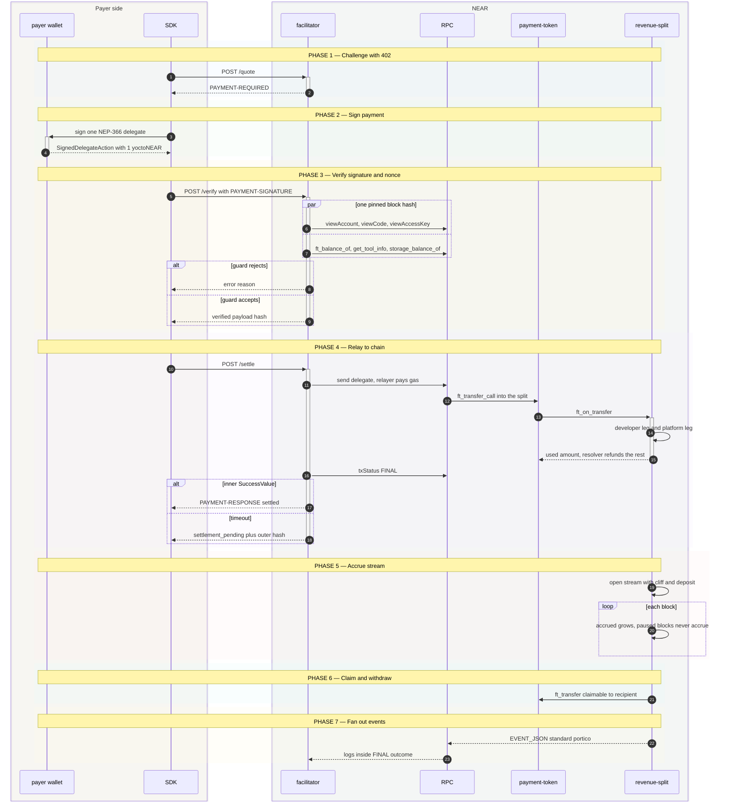

# portico

portico implements the x402 v2 `exact` payment scheme on NEAR for paid APIs. A buyer signs a NEP-366 `SignedDelegateAction` with one NEP-141 `ft_transfer_call` into a revenue-split contract. A relayer submits the delegate and pays gas plus 1 yoctoNEAR. The contract splits each sale between the developer and the platform, then appends it to a public ledger. Subscription revenue streams accrue per block for permissionless claims.

License: Apache-2.0 (see `LICENSE`, `NOTICE`, and `ATTRIBUTION.md`). Tracks: `realworld`, `business`. Baseline: tag `pre-hackathon` at `9f6b73f`; diff `git diff pre-hackathon..hackathon-submission`. Q-015 (second project on the same email): **eidolon** (agent village economy, tracks `games`, `agents`).



## Primitives

- Network: `near:testnet` (CAIP-2), x402 version 2, scheme `exact`; testnet accounts `portico.testnet`, `split.portico.testnet`, `token.portico.testnet`, `relayer.portico.testnet`
- Payment FT: self-deployed NEP-141, **18 decimals**, raw-unit amounts — portico's **own payment-token, not a third-party stablecoin**; no USDC or other issuer token is used anywhere
- **NEP-141 / NEP-145** — `portico-payment-token` is the payment FT with 18 decimals and raw-unit amounts; `portico-revenue-split` receives it via one approval-free `ft_transfer_call` per sale, with standard FT storage management (`storage_deposit`, `storage_withdraw`, `storage_unregister`, `storage_balance_bounds`, `storage_balance_of`).
- **NEP-366** — `SignedDelegateAction` relay: the buyer signs, the relayer submits. The nonce is bounded by `block_height * 1_000_000`; `maxTimeoutSeconds` maps to `blockHeightTtl` at one second per block.
- **NEP-297** — `EVENT_JSON` events for sales, splits, ledger entries, and streams.

## Origin and license disclosure

This repository ports [Sperax/x402-stablecoin](https://github.com/Sperax/x402-stablecoin) to NEAR. The root `LICENSE` is Apache License 2.0 and governs the repository; some origin files carry MIT SPDX headers and MIT metadata, and that conflict resolves to the root license. `NOTICE` records attribution and `ATTRIBUTION.md` records the upstream import. The Solidity contracts are not copied — the NEAR contracts are an independent Rust implementation; `near-sdk-contract-tools` is dual-licensed `GPL-3.0 OR Apache-2.0` and this project elects Apache-2.0. The revenue-split path uses `ft_transfer_call`, a documented extension of the NEAR `exact` scheme (which allows `ft_transfer`): it keeps `args.receiver_id == accepted.payTo` by setting `payTo` to the split contract, and the `msg` dispatcher binds the quoted tool to its registered developer. All other rules stay unchanged.

## Architecture and layout

```
contracts/
  revenue-split/    portico-revenue-split — NEP-141 receiver, tool registry, per-block streams, ledger, NEP-297 events
  payment-token/    portico-payment-token — NEP-141 FT with NEP-145 storage
facilitator/        Express quote/verify/settle relayer and quote API
packages/sdk/       @portico/sdk — x402 v2 types, headers, NEP-366 builders
mcp/                stdio MCP server exposing five x402 payment tools
examples/paywall/   merchant API: 402 → payment → fulfillment
scripts/
  sandbox-demo.ts   zero-funds local near-sandbox orchestration
  demo.ts           zero-funds sale → split → ledger → stream loop
  deploy-ft.ts      testnet FT deploy and demo-account seeding
  bench.ts          N=20 gas and latency measurement
tests/              near-workspaces Rust integration tests
```

## Measured performance

**Testnet (2026-11-12): 12.567 TGas and 11.03 s p50 / 11.82 s p95 per gasless sale→80/20 payout.** The run used N=20, all inner FT receipts returned `SuccessValue`, each loop has 12 receipts, and total burnt was 0.022456027285 NEAR. The delegated gas cap stays 100 TGas, the `exact` cap; the split signs one `ft_transfer_call` with `teraToGas(100)`; per-sale latency measures wall time from quote request to FINAL. Accounts: `split.portico.testnet`, `token.portico.testnet`, relayer `portico.testnet`, buyer `nearhack-major.testnet`, RPC `https://test.rpc.fastnear.com`, facilitator `http://127.0.0.1:3002`. Sandbox row (2026-11-12, `near-sandbox` 2.14.0 — **not comparable**): N=20, p50 12.195 TGas, p50 1.385 s, all inner FT receipts `SuccessValue`; local block production and polling dominate that row.

```bash
pnpm bench           # root script: tsx scripts/bench.ts, human summary
pnpm bench --json    # machine-readable output
```

## Quickstart — zero-funds sandbox

1. Build and run the sandbox demo → see `POST /quote` answered with HTTP 402 and the literal header `PAYMENT-REQUIRED` in the demo transcript (`../portico-demo-transcript.txt`).
2. After the loop finishes → see the final stdout line `OK: quote -> verify -> settle -> ledger sale -> stream -> claim in <ms> ms (< 120000 ms)` and exit code 0.
3. If anything fails → see stderr `portico demo failed: <reason>` and exit code 1; over-budget runs print `demo took <ms> ms, exceeding the 120000 ms budget`.

```bash
pnpm install
# build the two WASMs first (cargo-near)
(cd contracts/revenue-split && cargo near build non-reproducible-wasm)
(cd contracts/payment-token && cargo near build non-reproducible-wasm)
pnpm sandbox:demo             # root script: tsx scripts/sandbox-demo.ts
```

```text
 Test Files  7 passed (7)
      Tests  61 passed (61)
   Start at  20:43:57
   Duration  10.84s (transform 50%, import 47%, tests 3%, worker 1%)
```

## Testnet quickstart

```bash
cp .env.example .env          # fill in contract ids and relayer/buyer keys
pnpm install
pnpm deploy:ft                # builds + deploys the FT, registers demo accounts
(cd contracts/revenue-split && cargo near build non-reproducible-wasm)

near contract deploy split.portico.testnet \
  use-file contracts/revenue-split/target/near/portico_revenue_split.wasm \
  with-init-call new \
  json-args '{"owner_id":"portico.testnet","ft_account_id":"token.portico.testnet","platform_wallet":"portico.testnet","platform_fee_bps":2000}' \
  prepaid-gas '100 Tgas' attached-deposit '0 NEAR' \
  network-config testnet sign-with-keychain send

near contract call-function as-transaction split.portico.testnet register_tool \
  json-args '{"name":"web-search","developer":"dev1.portico.testnet","price":"1000000"}' \
  prepaid-gas '100 Tgas' attached-deposit '0.1 NEAR' \
  sign-as portico.testnet network-config testnet sign-with-keychain send
```

Fund `split.portico.testnet` with 1 NEAR for payment-path storage headroom. `register_tool` refunds excess deposit above storage growth plus the 8,192-byte reserve; its `price` is `1000000` raw units (Step 8), not the quote amount — `POST /quote` for `web-search` returns `100000000000000`, and `pay_tool` charges the registered price and refunds the difference, so net spend is `1000000`. `scripts/demo.ts` compares the quote to `PORTICO_DEMO_EXPECTED_AMOUNT` if set; set it to `accepts[0].amount` (`100000000000000` for `web-search`), or remove the line.

```bash
pnpm --filter @portico/facilitator dev   # :3002
pnpm --filter paywall dev                # :3003
pnpm demo                                # zero-NEAR buyer loop, asserts < 120000 ms
pnpm bench                               # N=20 measured gas/latency
```

## Facilitator API

```bash
pnpm --filter @portico/facilitator dev

curl -i -X POST http://localhost:3002/quote \
  -H 'content-type: application/json' \
  -d '{"service":"web-search"}'
curl -s http://localhost:3002/supported
curl -s http://localhost:3002/quote/pricing
curl -s http://localhost:3002/health
```

`POST /quote` returns HTTP 402 with `PAYMENT-REQUIRED` and a `PaymentRequired` JSON body; `accepts[].extra` sets `paymentFlow: "upfront"` (`/verify` → `/settle` runs before `authorization`). `GET /supported` returns x402 v2 kinds, empty `extensions`, and relayer `signers`. `POST /verify` is read-only and never broadcasts. `POST /settle` relays once and requires inner `SuccessValue` at FINAL; an RPC failure returns HTTP 202 `settlement_pending` with the outer hash for reconciliation. `GET /payments` and `GET /payments/:txHash` query the cache and RPC status.

## Paywall example

```bash
pnpm --filter paywall dev
curl -i http://localhost:3003/premium
```

## MCP server

```bash
pnpm --filter @portico/mcp start
# or, after pnpm build:
node mcp/dist/mcp-server.js
```

The server speaks newline-delimited JSON-RPC 2.0 on stdio (protocol `2024-11-05`, name `portico-x402`). It exposes `x402_quote`, `x402_pay`, `x402_balance`, `x402_verify_payment`, and `x402_estimate_cost`; it reads `PORTICO_TOKEN_CONTRACT`, `PORTICO_SPLIT_CONTRACT`, `FACILITATOR_URL`, `PORTICO_RPC_URL`, `PORTICO_NETWORK`, and — for `x402_pay` — `PORTICO_BUYER_ACCOUNT` plus `PORTICO_BUYER_SECRET_KEY`. Failures return `isError: true` so the transport stays alive.

## Environment

| Variable                                                                                                  | Default                                                  | Meaning                                                           |
| --------------------------------------------------------------------------------------------------------- | -------------------------------------------------------- | ----------------------------------------------------------------- |
| `PORTICO_RPC_URL` / `PORTICO_NETWORK`                                                                     | `https://test.rpc.fastnear.com` / `near:testnet`         | JSON-RPC endpoint, CAIP-2 network in `accepts[]`                  |
| `PORTICO_SPLIT_CONTRACT` / `PORTICO_TOKEN_CONTRACT` / `PORTICO_EXPECTED_DECIMALS`                         | `split.portico.testnet` / `token.portico.testnet` / `18` | revenue-split contract, payment FT, asserted FT decimals          |
| `PORTICO_RELAYER_ID` / `PORTICO_RELAYER_SECRET_KEYS`                                                      | `relayer.portico.testnet` / —                            | relayer account, JSON array of ed25519 keys                       |
| `PORTICO_PLATFORM_WALLET` / `PORTICO_FEE_BPS`                                                             | `portico.testnet` / `2000`                               | fee recipient, platform fee `0..=5000`                            |
| `PORTICO_FACILITATOR_PORT` / `FACILITATOR_URL` / `PORTICO_ALLOWED_ORIGINS`                                | `3002` / `http://localhost:3002` / empty (reflect)       | HTTP port, public URL used in quotes, browser origins             |
| `PORTICO_MAX_TIMEOUT_SECONDS` / `PORTICO_FINALITY_LAG_BLOCKS` / `PORTICO_SETTLEMENT_CACHE_TTL_MS`         | `60` / `3` / `120000`                                    | delegate TTL and block budget, finality allowance, cache TTL      |
| `RATE_LIMIT_WINDOW_MS` / `RATE_LIMIT_MAX`                                                                 | `60000` / `100`                                          | rate-limit window, requests per window                            |
| `PORTICO_BUYER_ACCOUNT` / `PORTICO_BUYER_SECRET_KEY`                                                      | `buyer1.portico.testnet` / —                             | zero-NEAR buyer account, full-access key                          |
| `PORTICO_STREAM_SUBSCRIBER_ACCOUNT` / `PORTICO_STREAM_SUBSCRIBER_SECRET_KEY` / `PORTICO_STREAM_RECIPIENT` | `streamer.portico.testnet` / — / `PORTICO_DEV_ACCOUNT`   | stream funder, funder key, stream payee                           |

Paywall variables live in `.env.example` and `examples/paywall/src/index.ts`: `PORTICO_TOKEN_CONTRACT`, `PORTICO_SPLIT_CONTRACT`, `PAYWALL_PORT` 3003, `PAYWALL_PRICE` 1000000 raw units, `PAYWALL_TOOL` `web-search`, `PAYWALL_RESOURCE_URL`, `PAYWALL_DESCRIPTION`, `PAYWALL_MAX_TIMEOUT_SECONDS`, `PAYWALL_ALLOWED_ORIGINS`.

## Protocol notes

- **Exact amounts and gas budget.** The facilitator checks `methodName ∈ {ft_transfer, ft_transfer_call}`, `args.amount == accepted.amount`, and `args.receiver_id == accepted.payTo`; the `msg` binds the action and tool to the developer. The split path signs `ft_transfer_call` with `teraToGas(100)`, the single-transfer path uses 30 Tgas, payouts 10 Tgas, and resolver callbacks 5 Tgas.
- **Callbacks return `U128` and never panic.** `on_payout_done` restores developer balances on payout failure and returns the payer's unused amount unchanged. `on_stream_payout_done` restores claim state and returns the failed amount. `on_stream_refund_done` restores the deposit and returns the failed amount. The NEP-141 resolver refunds that value.
- **Fee bounds.** `0..=5000` basis points. The platform leg is `amount * fee_bps / 10000` (floored). The developer receives the remainder so both legs sum to the sale.
- **Streams.** `cliff_blocks` starts at `start_block` and saves `cliff_end_block` (`3600..=31536000` blocks). Paused blocks do not accrue. Claims pay no bonus. `accrued` caps at the deposit. `claimable = accrued - withdrawn`. This keeps `accrued + escrow_remaining == deposit`.
- **Ledger.** `get_ledger(after_id, limit)` clamps limit to `1..=100`. After 100,000 entries, ledger writes stop while events continue for off-chain indexers.
- **Duplicate settlement and CORS.** The cache keys on payload hash, fails closed, and evicts at `max_block_height` or TTL expiry. CORS exposes `PAYMENT-REQUIRED` and `PAYMENT-RESPONSE`, allows `PAYMENT-SIGNATURE` and `Content-Type`, always sets `Vary: Origin`, and answers `OPTIONS` unpaid.

## Limits and scope

- **The relayer prepays.** The buyer needs a full-access key and zero liquid NEAR. The relayer pays gas and 1 yoctoNEAR. On failure, unused FT returns to the relayer, capping exposure at gas plus 1 yocto.
- **Asynchronous finality.** `/settle` can return HTTP 202 `settlement_pending` with the outer hash. Poll `/payments/:txHash` and do not re-sign. The cache blocks duplicate settlement.
- **Storage headroom caps.** Payment writes are unfunded since `ft_on_transfer` carries no NEAR. Caps are 10,000 balance keys, 10,000 streams, and 100,000 ledger entries. Adding a key requires `storage_byte_cost * (storage_usage + entry_bytes + 32768)` liquid balance. Exceeding a cap or headroom refunds the payment unused.
- **No custody, no yield.** The facilitator holds zero funds; the contract holds stream escrow and withdrawable developer balances only, and no mainnet deploy or real-asset custody exists. Streams are payment schedules, not investments: they accrue a prepaid budget per block without yield or APY claims.

## Tests and requirements

```bash
cargo test --manifest-path contracts/revenue-split/Cargo.toml
cargo test --manifest-path contracts/payment-token/Cargo.toml
cargo test --manifest-path tests/Cargo.toml   # near-workspaces, needs built WASMs
pnpm -r test
pnpm typecheck
pnpm lint
```

- Node.js >= 26.13.1 and pnpm >= 12.18.0 (repository floor; `near-api-js` 7.5.3 itself requires Node >= 22.22.2)
- Rust 1.100.0 pinned in `rust-toolchain.toml` (MSRV 1.95) with `wasm32-unknown-unknown`
- `cargo-near` 0.23.0 and `near-cli-rs` 0.31.1 for deployments
- `near-sandbox` for the local sandbox quickstart; a NEAR testnet account in the `near` CLI keychain for testnet runs

## Baseline and disclosure

- Baseline: tag `pre-hackathon` marks the imported tree at `9f6b73f`. The upstream project is `x402-stablecoin`.
- Submission: tag `hackathon-submission` marks the submitted state. `git rev-parse --short hackathon-submission` prints it.
- Diff: `git diff pre-hackathon..hackathon-submission`. After publishing, https://github.com/<owner>/<repo>/compare/pre-hackathon...hackathon-submission.
- Libraries, templates and AI-generated code are listed in `ATTRIBUTION.md` and `NOTICE`.

## License and hackathon

Apache-2.0. See `LICENSE`, `NOTICE`, and `ATTRIBUTION.md`. Tracks: `realworld`, `business`. Submission checklist and payload fields: `SUBMISSION-PREP.md`.
