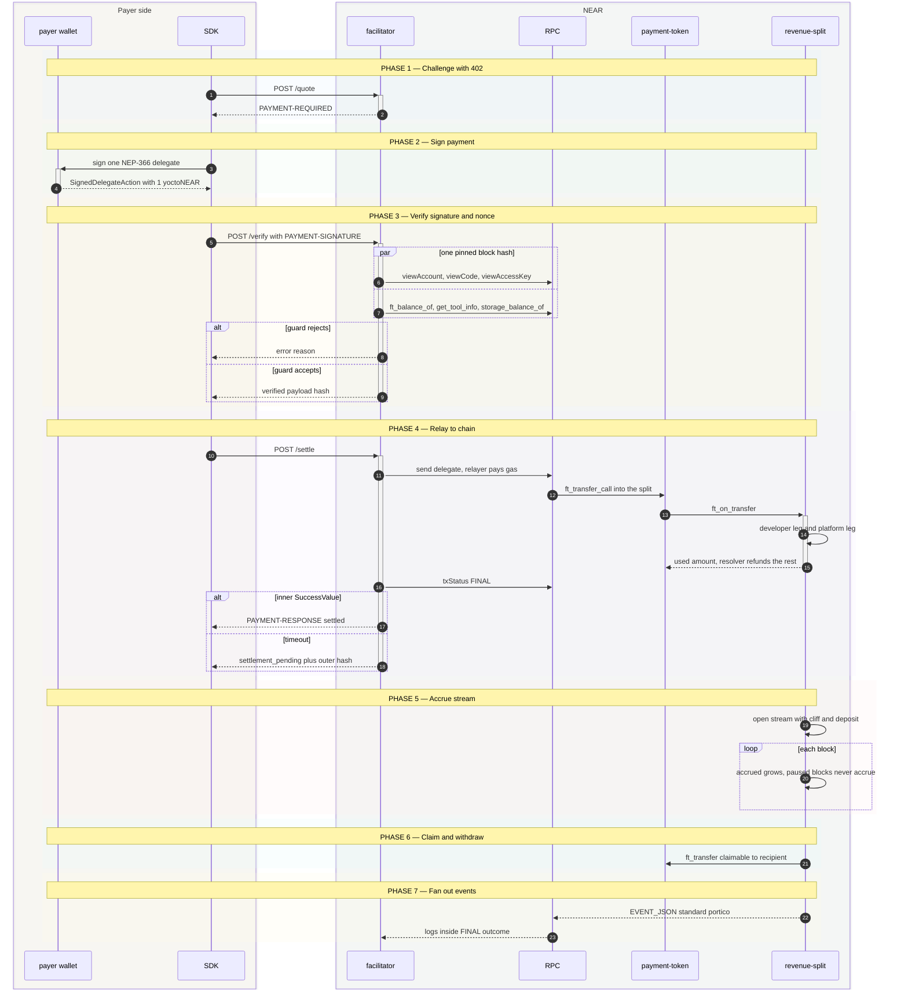

# portico

Tracks `realworld`, `business` · Apache-2.0 (`LICENSE`, `NOTICE`, `ATTRIBUTION.md`) · baseline tag `pre-hackathon` at `9f6b73f` (`x402-stablecoin`); submission `hackathon-submission` (`git rev-parse --short hackathon-submission`); diff `git diff pre-hackathon..hackathon-submission` · Q-015 sibling **eidolon** (agent village economy, tracks `games`, `agents`).

Paid APIs on NEAR: a buyer signs one NEP-366 delegate carrying a NEP-141 transfer, a relayer pays gas, and a contract splits revenue between developer and platform. Subscriptions accrue per block for permissionless claims, so any API can charge per call.



```bash
pnpm install
(cd contracts/revenue-split && cargo near build non-reproducible-wasm)
(cd contracts/payment-token && cargo near build non-reproducible-wasm)
pnpm sandbox:demo
pnpm demo
pnpm bench
pnpm -r test
pnpm typecheck
```

| Do this | See this | Proves |
| --- | --- | --- |
| `pnpm install`; `pnpm sandbox:demo` | deploys token/split/relayer, one gasless sale; HTTP 402 `PAYMENT-REQUIRED`; exit 0 | end-to-end payment |
| `pnpm bench`; `pnpm bench --json` | 12.567 TGas and 11.03 s p50 / 11.82 s p95 per sale | cost is real |
| `pnpm -r test`; `cargo test --manifest-path tests/Cargo.toml` | all pass (61 tests) | behavior tested |
| `cp .env.example .env`; `pnpm deploy:ft` | `register_tool` `web-search`; net spend `1000000` raw units | testnet deploy works |
| `pnpm --filter @portico/facilitator dev`; `curl -i -X POST http://localhost:3002/quote` | HTTP 402 `PAYMENT-REQUIRED`; `/verify` → `/settle`; HTTP 202 `settlement_pending` | x402 v2 `exact` over HTTP 402 |
| `pnpm --filter paywall dev`; `pnpm demo` | 402 → payment → fulfillment; asserts < 120000 ms | merchant paywall works |
| `pnpm --filter @portico/mcp start`; `node mcp/dist/mcp-server.js` | JSON-RPC 2.0 stdio, protocol `2024-11-05`, five `x402_*` tools | five x402 payment tools |
| NEP-141 / NEP-145 FT (18 decimals); NEP-366 `SignedDelegateAction` | NEP-297 `EVENT_JSON`; `near:testnet` (CAIP-2); x402 v2 `exact` | NEP-141/145/366/297 |
| `PORTICO_RPC_URL`=`https://test.rpc.fastnear.com`; `PORTICO_FEE_BPS`=`2000` | fee `0..=5000` bps; 100,000-entry ledger cap | config + invariants |
| `git diff pre-hackathon..hackathon-submission`; `git rev-parse --short hackathon-submission` | tag `pre-hackathon` at `9f6b73f`; upstream `x402-stablecoin` | baseline disclosed |
| "The delegated gas cap stays 100 TGas, the `exact` cap" | "The revenue-split path uses `ft_transfer_call`, a documented extension of the NEAR `exact` scheme (which allows `ft_transfer`)" | Limits: relayer prepays gas + 1 yoctoNEAR; no custody, no yield |

[ATTRIBUTION](ATTRIBUTION.md) · [LICENSE](LICENSE) · origin [Sperax/x402-stablecoin](https://github.com/Sperax/x402-stablecoin) (Apache-2.0).
